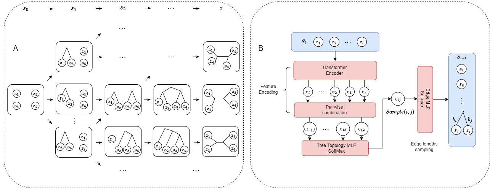
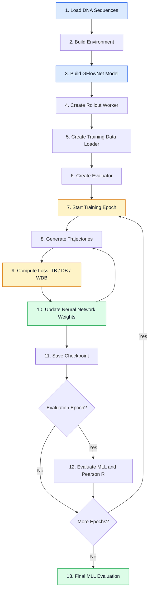

# PhyloGFN: Phylogenetic inference with generative flow networks
Official repository of [PhyloGFN: Phylogenetic inference with generative flow networks](https://openreview.net/forum?id=hB7SlfEmze) (ICLR 2024)

Mingyang Zhou, Zichao Yan, Elliot Layne, Esmeralda S. Whitammer, Dinghuai Zhang, Moksh Jain, Mathieu Blanchette, Yoshua Bengio



We design a GFlowNet based generative model for phylogenetic inference, achieving strong results in both Bayesian and parsimony-based phylogenetic inference.

## PhyloGFN-Net — Training Pipeline

The main training pipeline is implemented in
[`train_net.py`](train_net.py).

This script controls the complete training process:
loading DNA sequences, creating the environment and GFlowNet,
generating trajectories, computing the training loss,
updating model parameters, saving checkpoints, and evaluating
model performance.

### Training Pipeline Flowchart



### Code Implementation

| Step | Description | Source Code |
|---|---|---|
| 1 | Load DNA sequences | [train_net.py, L72](train_net.py#L72) |
| 2 | Build environment | [train_net.py, L73-L74](train_net.py#L73-L74) |
| 3 | Build GFlowNet | [train_net.py, L75](train_net.py#L75) |
| 4 | Create rollout worker | [train_net.py, L76](train_net.py#L76) |
| 5 | Create training data loader | [train_net.py, L77](train_net.py#L77) |
| 6 | Create evaluator | [train_net.py, L78](train_net.py#L78) |
| 7 | Start training epochs | [train_net.py, L84](train_net.py#L84) |
| 8 | Generate training trajectories | [train_net.py, L94-L98](train_net.py#L94-L98) |
| 9 | Compute training loss | [train_net.py, L99](train_net.py#L99) |
| 10 | Update model parameters | [train_net.py, L100-L102](train_net.py#L100-L102) |
| 11 | Save checkpoint | [train_net.py, L114-L115](train_net.py#L114-L115) |
| 12 | Evaluate MLL and Pearson R | [train_net.py, L123-L129](train_net.py#L123-L129) |
| 13 | Final MLL evaluation | [train_net.py, L132-L134](train_net.py#L132-L134) |

### Main Training Components

**Environment**

Defines valid actions, state transitions, and rewards
for constructing phylogenetic networks.

**GFlowNet Model**

Learns a policy for selecting merge and reticulation actions.

**Rollout Worker**

Generates trajectories that construct complete networks.

**Training Data Loader**

Prepares training batches using newly sampled trajectories
and stored high-scoring networks.

**Training Objectives**

Three objectives are supported:

- **TB (Trajectory Balance):** Applies a balance condition to a complete trajectory.
- **DB (Detailed Balance):** Applies balance conditions to individual transitions.
- **WDB (Weighted Detailed Balance):** Uses weighted transition-level balance conditions.

The selected objective depends on the configuration.

Loss implementation:
[`src/gfn/tb_gfn_net.py`](src/gfn/tb_gfn_net.py)

**Model Updates**

Backpropagation calculates gradients, and the optimizer
updates the neural network parameters.

**Checkpointing**

Model and optimizer states are saved for later loading
and evaluation.

**Evaluation**

Marginal log-likelihood (MLL) and Pearson correlation
are evaluated at configured training intervals.

After training, a final MLL evaluation is performed
three times, and the mean and standard deviation are reported.

### Main Source Files

| File | Responsibility |
|---|---|
| [`train_net.py`](train_net.py) | Main training pipeline |
| [`src/gfn/tb_gfn_net.py`](src/gfn/tb_gfn_net.py) | Model, training loss, and optimizer |
| [`src/gfn/rollout_worker_net.py`](src/gfn/rollout_worker_net.py) | Trajectory generation |
| [`src/gfn/training_data_loader_net.py`](src/gfn/training_data_loader_net.py) | Training batch preparation |
| [`src/gfn/gfn_evaluator_net.py`](src/gfn/gfn_evaluator_net.py) | MLL and Pearson evaluation |

## Citation
```bibtex
@inproceedings{
    zhou2024phylogfn,
    title={Phylo{GFN}: Phylogenetic inference with generative flow networks},
    author={Ming Yang Zhou and Zichao Yan and Elliot Layne and Esmeralda S. Whitammer and Dinghuai Zhang and Moksh Jain and Mathieu Blanchette and Yoshua Bengio},
    booktitle={The Twelfth International Conference on Learning Representations},
    year={2024},
    url={https://openreview.net/forum?id=hB7SlfEmze}
}
```


## Environment Setup

```
conda create -n phylogfn python=3.10
conda activate phylogfn
conda install pytorch torchvision torchaudio pytorch-cuda=11.8 -c pytorch -c nvidia
conda install anaconda::docopt
conda install etetoolkit::ete3
conda install matplotlib tqdm dill fvcore iopath docopt
```

## Usage
Our latest progress with continuous branch lengths modeling is implemented. To train a phyogfn model

```buildoutcfg
python train.py <cfg_path> <sequences_path> <output_path> [--nb_device=<device_num>] [--quiet] [--amp]
```
- Example sequences datasets DS1-DS8 are stored in the folder `dataset/benchmark_datasets`
- Example training `<cfg_path>` are stored in the folder `src/configs/benchmark/dna_cfgs`
    - Continuous branch lengths modeling configs are in the folder `continuous_branch_lengths_modeling`
    - Discrete branch lengths modeling configs are in the folder `discrete_branch_lengths`

PhyloGFN with continuous branch length modeling achieves SOTA MLL estimation performance.

|                | Training trajs |     DS1         |     DS2         |     DS3         |     DS4         |     DS5         |     DS6         |     DS7         |     DS8         |  cfg/weights       |
|----------------|----------------|-----------------|-----------------|-----------------|-----------------|-----------------|-----------------|-----------------|-----------------|----------------|
| PhyloGFN Full |    3.20E+07    | -7108.4 (0.04)  | -26367.7 (0.04) | -33735.1 (0.02) | -13329.9 (0.09) | -8214.4 (0.16)  | -6724.2 (0.10)  | -37331.9 (0.14) | -8650.5 (0.05)  |       -        |
| PhyloGFN 40%  |    1.28E+07    | -7108.4 (0.05) | -26367.7 (0.05) | -33735.2 (0.04) | -13330.1 (0.07) | -8214.5 (0.14)  | -6724.3 (0.10)  | -37332.1 (0.27) | -8650.4 (0.16)  |       -        |
| PhyloGFN 24%  |    7.68E+06    | -7108.4 (0.05) | -26367.7 (0.02) | -33735.1 (0.07) | -13330.0 (0.08) | -8214.5 (0.13)  | -6724.2 (0.21)  | -37332.2 (0.26) | -8650.4 (0.15)  | [googledrive](https://drive.google.com/drive/folders/1TbpnCUMvLdYxfr71nY_k5_BftPlaxKYW?usp=drive_link)|


For discrete branch lengths modeling, we suggest to use the config file with the following configurations:

|         |  DS1  |  DS2  |  DS3  |  DS4  |  DS5  |  DS6  |  DS7  |  DS8  |
|---------|-------|-------|-------|-------|-------|-------|-------|-------|
| Bin size| 0.001 | 0.004 | 0.004 | 0.002 | 0.002 | 0.001 | 0.001 | 0.001 |
| Bin num |   50  |   50  |   50  |  100  |  100  |  100  |  200  |  100  |

We will publish the optimized code for parsimony analysis in the near future. In the meantime, if you are interested, please refer to the [supplementary materials](https://openreview.net/attachment?id=hB7SlfEmze&name=supplementary_material) to run parsimony analysis.


## Experimental Results

Results are now organised by experiment type:

- [Phylogenetic tree baseline](results/tree/DS1/README.md)
- [Phylogenetic network](results/network/DS1/README.md)
- [Phylogenetic network + KNN](results/network_knn/DS1/README.md)
- [All experimental results](results/README.md)

## TODO list
- [ ] mutigpu training 
- [ ] parsimony inference


