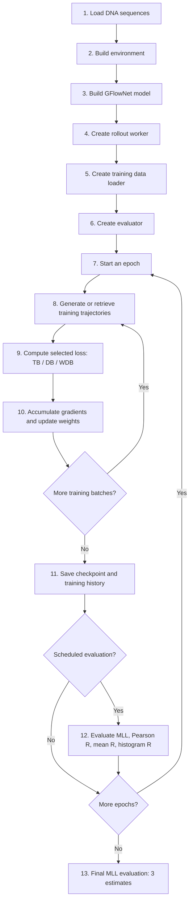

# PhyloGFN-Net — Level-1 Phylogenetic Networks with GFlowNets

## Overview

**PhyloGFN-Net** extends the original **PhyloGFN** implementation (Zhou et al., ICLR 2024) from phylogenetic **trees** to **level-1 phylogenetic networks**. A tree describes evolutionary relationships through branching. A network can also represent **reticulation events**, where a lineage has two ancestral connections.

In a **level-1 network**, reticulation cycles do not overlap. The network environment restricts actions to keep the generated structures in this class. A configurable limit, `R_MAX`, controls the maximum number of reticulation events.

The original tree-based path remains available through `train.py` and `ENV.ENVIRONMENT_TYPE: ONE_STEP_BINARY_TREE`. The network-based training entry point is [`train_net.py`](train_net.py), with `ENV.ENVIRONMENT_TYPE: ONE_STEP_LEVEL1_NETWORK`.

The goal is to **learn a probability distribution over phylogenetic networks that is consistent with their rewards**, rather than return only one best network.

A more technical explanation of the modifications is provided in [`lecture/main.pdf`](lecture/main.pdf), with LaTeX sources in [`lecture/`](lecture/).

## Tree Model vs. Network Model

| Feature | Original PhyloGFN (tree) | PhyloGFN-Net (network) |
|---|---|---|
| Main script | [`train.py`](train.py) | [`train_net.py`](train_net.py) |
| Structure | Phylogenetic tree | Level-1 phylogenetic network |
| Main construction action | `MERGE` | `MERGE` and `RETICULATE` |
| Reticulation events | None | Between 0 and `R_MAX` |
| Trajectory length | `N - 1` merge steps | `N - 1 + 2R` steps, where `R` is the number of reticulations |
| Rollout behavior | Equal-length tree trajectories | Variable-length network trajectories; finished trajectories are masked |
| Training objectives in this extension | Original TB baseline | TB, DB, and WDB |

`N` is the number of DNA sequences (leaves). A **trajectory** is the full sequence of actions from the initial state to a completed tree or network.

## What Changed — Implementation Map

The following table summarizes the network-specific additions and changes relative to the original PhyloGFN implementation.

| ID | Main file(s) | Responsibility |
|---|---|---|
| **M1–M7** | [`src/env/phylo_network_env.py`](src/env/phylo_network_env.py) | Network states; `MERGE` and `RETICULATE` actions; legal-action masks for level-1 networks; two-version Felsenstein likelihood features; reticulation prior; parent counting and backward transitions. |
| **M8** | [`src/model/network_model/one_step_network_model.py`](src/model/network_model/one_step_network_model.py), [`src/model/edges_model/continuous/network_heads.py`](src/model/edges_model/continuous/network_heads.py) | Neural network policy for pair/single-lineage actions; continuous branch-length and reticulation-parameter heads. |
| **M9** | [`src/utils/level1_counts.py`](src/utils/level1_counts.py) | Counts of level-1 topologies used for topology-prior normalization. |
| **M10** | [`src/gfn/tb_gfn_net.py`](src/gfn/tb_gfn_net.py) | Network GFlowNet generator; action routing; TB, DB, and WDB losses; optimizer and checkpoint methods. |
| **M11** | [`src/gfn/rollout_worker_net.py`](src/gfn/rollout_worker_net.py), [`src/gfn/training_data_loader_net.py`](src/gfn/training_data_loader_net.py), [`src/gfn/gfn_evaluator_net.py`](src/gfn/gfn_evaluator_net.py) | Variable-length trajectories, training batches/replay buffer, and MLL/Pearson/reticulation evaluation. |
| **M12** | [`src/configs/defaults.py`](src/configs/defaults.py), [`src/env/__init__.py`](src/env/__init__.py), [`src/gfn/build.py`](src/gfn/build.py), [`src/utils/utils.py`](src/utils/utils.py), [`train_net.py`](train_net.py), [`src/configs/network_cfgs/`](src/configs/network_cfgs/), [`tools/`](tools/), [`tests/`](tests/) | Registration, configuration, training entry point, experiments, numerical checks, and tests. |

A patch showing the differences from the original repository is available as [`phylogfn-net.patch`](phylogfn-net.patch).

## Main Training Pipeline

[`train_net.py`](train_net.py) manages the training process. The detailed implementation is split across the environment, generator, rollout worker, data loader, and evaluator.

### Training Flowchart



The training loop runs for the number of epochs specified in the YAML configuration. Gradient updates occur after the configured number of mini-batch splits. Checkpoints are saved after each epoch, while the periodic quality evaluation runs at the configured `EVALUATION_FREQ`.

### Step-by-Step Code Guide

| Step | What happens | Main code location |
|---|---|---|
| **1. Load sequences** | Read DNA sequences from a `.pickle` or FASTA input. | [`train_net.py`](train_net.py) — `load_sequences(sequences_path)` |
| **2. Build environment** | Create the network state space, valid actions, transitions, and reward function. | [`train_net.py`](train_net.py) — `build_env(cfg, all_seqs)`; [`src/env/__init__.py`](src/env/__init__.py) |
| **3. Build GFlowNet** | Construct the neural network generator for the chosen environment type. | [`train_net.py`](train_net.py) — `build_gfn(...)`; [`src/gfn/build.py`](src/gfn/build.py) |
| **4. Create rollout worker** | Prepare the component that builds networks step by step. | [`train_net.py`](train_net.py) — `RolloutWorkerNet(...)`; [`src/gfn/rollout_worker_net.py`](src/gfn/rollout_worker_net.py) |
| **5. Create data loader** | Prepare training batches, including sampled trajectories and replay data. | [`train_net.py`](train_net.py) — `TrainingDataLoaderNet(...)`; [`src/gfn/training_data_loader_net.py`](src/gfn/training_data_loader_net.py) |
| **6. Create evaluator** | Prepare quality checks for the trained model. | [`train_net.py`](train_net.py) — `GFNEvaluatorNet(...)`; [`src/gfn/gfn_evaluator_net.py`](src/gfn/gfn_evaluator_net.py) |
| **7. Start epochs** | Repeat training for the configured number of epochs. | [`train_net.py`](train_net.py) — `for epoch in range(...)` |
| **8. Generate trajectories** | Choose and apply actions until each network is complete; collect probabilities and rewards. | [`src/gfn/rollout_worker_net.py`](src/gfn/rollout_worker_net.py) — `rollout(...)` |
| **9. Compute loss** | Calculate TB, DB, or WDB from the rollout outputs, according to the configuration. | [`src/gfn/tb_gfn_net.py`](src/gfn/tb_gfn_net.py) — `get_loss_from_rollout_outputs(...)`, `db_loss(...)` |
| **10. Update weights** | Backpropagate the loss and apply the Adam optimizer. | [`src/gfn/tb_gfn_net.py`](src/gfn/tb_gfn_net.py) — `accumulate_loss(...)`, `update_model(...)` |
| **11. Save checkpoints** | Save model and optimizer states, plus training history. | [`train_net.py`](train_net.py) — `generator.save(ckpt)`; [`src/gfn/tb_gfn_net.py`](src/gfn/tb_gfn_net.py) — `save(...)` |
| **12. Evaluate model** | Report estimated MLL, Pearson correlation, mean reticulation count, and its histogram. | [`train_net.py`](train_net.py) — `evaluate_gfn_quality(True)`; [`src/gfn/gfn_evaluator_net.py`](src/gfn/gfn_evaluator_net.py) |
| **13. Final MLL** | Estimate MLL three times and report its mean and standard deviation. | [`train_net.py`](train_net.py) — `evaluate_marginal_likelihood(1024)` |

### How a Network Trajectory Is Generated

A network is not created in one action. The rollout worker starts from the initial state and constructs it step by step:

1. Get an initial state from the environment.
2. Ask the GFlowNet policy to select a valid `MERGE` or `RETICULATE` action.
3. Apply the action using the environment.
4. Record forward and backward log-probabilities.
5. Add the selected action to the trajectory.
6. Stop updating that trajectory once its network is complete.
7. Record the reward and score for the final network.

For a network with `N` leaves and `R` reticulations, the trajectory has `N - 1 + 2R` actions. Different trajectories in the same batch may therefore finish at different times; the rollout worker processes only the unfinished trajectories.

Relevant code: [`src/gfn/rollout_worker_net.py`](src/gfn/rollout_worker_net.py).

## Training Objectives: TB, DB, and WDB

The network model supports three related objectives, selected by `GFN.NET_LOSS` in the configuration.

| Method | Simple explanation | Difference |
|---|---|---|
| **TB — Trajectory Balance** | Checks the balance condition over the entire trajectory. | One trajectory-level objective. |
| **DB — Detailed Balance** | Checks the balance condition for each transition between two states. | Uses a learned state flow, `F(s)`. |
| **WDB — Weighted Detailed Balance** | Checks individual transitions as DB does, but uses a weight for each transition. | The weighting rule is selected with `GFN.WDB_GAMMA`. |

For TB, the trajectory-balance objective is

$$
\mathcal{L}_{\mathrm{TB}}(\tau)=\left[\log Z+\sum_t\log P_F(s_{t+1}\mid s_t)-\log R(x)-\sum_t\log P_B(s_t\mid s_{t+1})\right]^2.
$$

- `P_F`: probability of choosing the next action (forward policy).
- `P_B`: probability of reversing a transition (backward policy). In this implementation it is uniform over valid parent states.
- `R(x)`: reward of the completed network `x`.
- `Z`: a learned normalization parameter for TB.

For DB and WDB, each transition has a balance residual. **DB** averages squared transition residuals. **WDB** instead uses a normalized weighted average of the squared residuals.

Two WDB variants used in the N4 experiment are:

- **WDB-count**: weights are inversely related to the number of possible topology completions from a state.
- **WDB-logcount**: uses the logarithm of that count so weights decrease less sharply when the number of completions is large.

The `flow_head` is trained for DB/WDB and excluded from the TB optimizer path. See [`src/gfn/tb_gfn_net.py`](src/gfn/tb_gfn_net.py).

## Setup and Basic Usage

Use the Python environment configured for this repository. The following packages are used by the documented scripts:

```bash
pip install torch numpy scipy tqdm dill docopt fvcore ete3 networkx pyyaml
```

### Check the Network Environment

```bash
python tests/test_network_env.py
python tests/test_db_wdb.py
```

### Generate a Small Simulated Dataset

```bash
python tools/simulate_network_data.py \
  dataset/simulated/sim6_r1.pickle \
  --leaves=6 --sites=300 --rets=1 --seed=3
```

### Train PhyloGFN-Net Directly

```bash
python train_net.py \
  src/configs/network_cfgs/cfg_net_small_cpu.yaml \
  dataset/simulated/sim6_r1.pickle \
  runs/sim6_r1 \
  --device=cpu
```

`train_net.py` accepts the following arguments:

```text
python train_net.py <cfg_path> <sequences_path> <output_path> \
  [--quiet] [--device=cpu|cuda] [--seed=<integer>]
```

The script creates a timestamped output directory. Its files include:

```text
runs/<timestamp>_<run_name>/
  config.yaml
  checkpoints/
    checkpoint_000000.pt
    checkpoint_000001.pt
    ...
  history.pkl
  final_mlls.p
```

Checkpoint files contain model and optimizer states. The training history records metrics and timing. Some evaluation files are created separately by the experiment scripts.

### Tree-Mode Comparison

For a comparison with the tree-only setting, the repository also provides:

```bash
python tools/compare_tree_mode.py \
  dataset/simulated/sim6_r1.pickle 8 40
```

Setting `R_MAX: 0` prevents reticulation events, so the network environment produces tree structures. Compatibility with the original PhyloGFN implementation is checked separately; structural equivalence alone does not establish identical training outcomes.

## Experimental Pipeline

The experiment orchestration script is [`run_paper_methods.sh`](run_paper_methods.sh). It generates configurations, runs tests, trains the model, and evaluates saved checkpoints.

### N4 — Small Reference Experiment

**Purpose:** Compare training objectives on a small problem where a numerical reference distribution can be estimated.

- **Dataset:** 4 DNA sequences, 100 sites each, generated using one reticulation in the simulation (`--leaves=4 --sites=100 --rets=1 --seed=5`).
- **Reference:** Approximate numerical posterior from [`tools/reference_posterior_small_n.py`](tools/reference_posterior_small_n.py).
- **Methods:** TB, DB, WDB-logcount, and WDB-count.
- **Seeds:** 5 per method, for **20 scheduled training runs**.
- **Evaluation:** TV distance, Flow Consistency Score (FCS), and time-resolved AUC comparisons against DB.

```bash
# Generate the method configuration files
bash run_paper_methods.sh cfgs

# Run the complete N4 workflow (CPU; may take time)
bash run_paper_methods.sh n4
```

N4 runs use the configuration files under [`src/configs/network_cfgs/paper/`](src/configs/network_cfgs/paper/): `n4_tb.yaml`, `n4_db.yaml`, `n4_wdb_logcount.yaml`, and `n4_wdb_count.yaml`.

The experiment script defines these outputs:

```text
runs/n4_reference.pkl        # cached numerical reference
runs/n4_reference.txt        # reference computation report
runs/n4_comparison.txt       # objective comparison report

runs/<timestamp>_n4_<method>_s<seed>/
  checkpoints/
  history.pkl
  endpoints.csv              # checkpoint-wise TV and FCS
  reference_tv.txt           # comparison against the reference
  fcs.txt                    # additional FCS diagnostics
```

These files appear only when their corresponding runs and evaluation steps finish successfully. No method is declared the winner without inspecting the actual output metrics.

### SIM6 — Larger Simulated Gate Experiment

The SIM6 workflow uses a simulated dataset with six leaves and compares TB, DB, and several WDB configurations, including a look-ahead variant. The script schedules three seeds per configuration and evaluates checkpoint-wise FCS and additional diagnostics.

```bash
bash run_paper_methods.sh sim6
```

### DS1–DS8 — Benchmark Experiments

The benchmark datasets are located under `dataset/benchmark_datasets/`, with network configurations in `src/configs/network_cfgs/paper/`.

For example, to launch the DS1 WDB-logcount configuration on CUDA:

```bash
bash run_paper_methods.sh ds 1 wdb_logcount cuda 1
```

The `ds` command launches training in the background and writes its log to a file. A memory benchmark can be run before larger datasets:

```bash
bash run_paper_methods.sh membench 7 wdb_logcount cuda
```

For an existing run directory, checkpoint-wise evaluation can be requested using:

```bash
bash run_paper_methods.sh eval <run_dir> <sequences_path> cuda 10
```

These commands describe the **configured experiment workflow**; they are not statements that every dataset run has already completed.

## Evaluation Metrics

Two evaluation workflows are provided:

1. **During training**, [`src/gfn/gfn_evaluator_net.py`](src/gfn/gfn_evaluator_net.py) reports estimated MLL, Pearson correlation, and reticulation-count statistics at configured intervals.
2. **After training**, [`tools/auc_endpoints.py`](tools/auc_endpoints.py), [`tools/reference_posterior_small_n.py`](tools/reference_posterior_small_n.py), and [`tools/fcs_eval.py`](tools/fcs_eval.py) evaluate saved checkpoints, including the metrics used in N4.

| Metric | Meaning |
|---|---|
| **Estimated MLL** | A marginal log-likelihood estimate based on the model and its evaluation procedure. |
| **Pearson correlation** | A correlation diagnostic reported by the evaluator. |
| **Mean R** | Mean number of reticulations in sampled networks. |
| **R histogram** | Counts of sampled networks with each reticulation count. |
| **TV distance** | Difference between the learned topology distribution and a numerical reference; lower is better. |
| **FCS** | Diagnostic of consistency between sampled network probabilities and rewards. |
| **AUC** | Summarizes the evolution of an evaluation metric over training time. |

**Important:** `R` as a reticulation count is different from Pearson's correlation coefficient. Also, the `log_score` of an individual sampled network is **not** the model's MLL estimate.

## Verification and Tests

The repository includes tests and comparison scripts for the network implementation. Their purposes include:

- Checking network transitions, legal-action masks, and the level-1 construction rules.
- Comparing the network likelihood calculation with explicit displayed-tree calculations on small test cases.
- Checking valid backward transitions and parent counting.
- Checking TB/DB/WDB losses, per-transition records, weights, and optimizer updates.
- Checking compatibility of the TB training path against the earlier baseline implementation.
- Checking the tree-only limit when `R_MAX` is zero.

Useful commands:

```bash
bash run_paper_methods.sh test
bash run_paper_methods.sh regress
```

These commands execute checks; reported numerical tolerances and pass/fail status should be taken from the corresponding test output rather than assumed from this README.

## Project Navigation

| Resource | Description |
|---|---|
| [`README.md`](README.md) | Main repository landing page and original project context. |
| [`README-NET.md`](README-NET.md) | This network-specific guide. |
| [`train_net.py`](train_net.py) | Main network training entry point. |
| [`run_paper_methods.sh`](run_paper_methods.sh) | N4, SIM6, DS, testing, and evaluation workflows. |
| [`src/configs/network_cfgs/`](src/configs/network_cfgs/) | Network experiment configurations. |
| [`tools/`](tools/) | Simulation, reference estimation, evaluation, and diagnostic utilities. |
| [`tests/`](tests/) | Implementation checks. |
| [`lecture/main.pdf`](lecture/main.pdf) | Detailed explanation of the network modifications. |

## References and Attribution

- **Original PhyloGFN:** Zhou et al., ICLR 2024. The tree-based implementation provides the starting point for this extension.
- **DB/WDB training methods:** da Silva et al., ICLR 2025, as referenced in the implementation.

PhyloGFN-Net is a research extension of the original PhyloGFN code, not a claim of official authorship of the original implementation.
