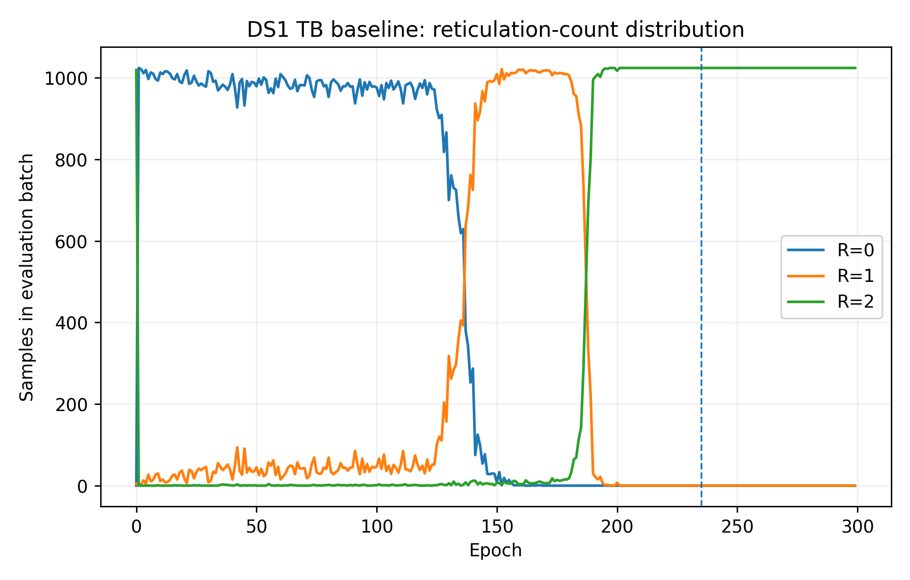

# DS1 complete TB baseline

## Experiment

- Dataset: `dataset/benchmark_datasets/DS1.pickle`
- Configuration: `src/configs/network_cfgs/cfg_net_DS1_300ep.yaml`
- Objective: Trajectory Balance (TB)
- Device: NVIDIA L40S / CUDA
- Seed: 1
- Requested training budget: 300 epochs

## Interruption and continuation

The original run completed epochs 0--235 and was then interrupted by a
`KeyboardInterrupt`.

Training was continued from
`checkpoint_000235.pt`. The checkpoint restores the model parameters and
optimizer state. The continuation starts at epoch 236.

Because the Python random stream was reinitialized when the resume process
started, the resumed segment is a continuation from the same trained state
but is not bitwise identical to an uninterrupted run.

The dashed vertical line at epoch 235 in the convergence figures marks this
boundary.

## Final result

- Final epoch: 299
- Final reported MLL: `-7043.143 ± 0.104`
- Final PearsonR: `0.975`
- Final mean reticulation count: `2.00`
- Final R histogram: `[0, 0, 1024]`

## Figures

### MLL convergence

### Pearson correlation

### Reticulation-count distribution

## Data

The compact epoch-wise data used for the figures are stored in:

`ds1_tb_metrics.csv`

Raw checkpoints and large run directories are intentionally not committed.
