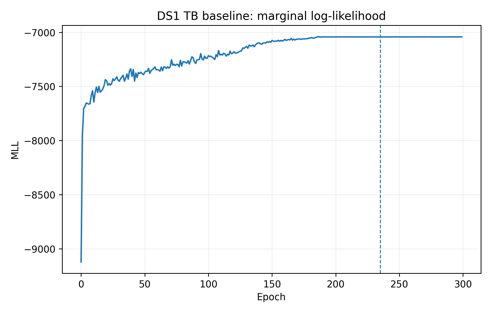
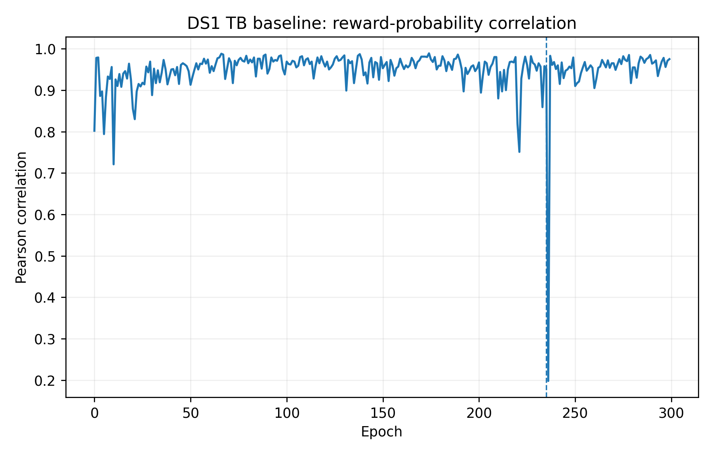

# DS1 complete TB baseline

## Experiment

- Dataset: `dataset/benchmark_datasets/DS1.pickle`
- Configuration: `src/configs/network_cfgs/cfg_net_DS1_300ep.yaml`
- Objective: Trajectory Balance (TB)
- Device: NVIDIA L40S / CUDA
- Seed: 1
- Requested training budget: 300 epochs

## Interruption and continuation

The original run completed epochs 0--235 and was then interrupted by a
`KeyboardInterrupt`.

Training was continued from
`checkpoint_000235.pt`. The checkpoint restores the model parameters and
optimizer state. The continuation starts at epoch 236.

Because the Python random stream was reinitialized when the resume process
started, the resumed segment is a continuation from the same trained state
but is not bitwise identical to an uninterrupted run.

The dashed vertical line at epoch 235 in the convergence figures marks this
boundary.

## Final result

- Final epoch: 299
- Final reported MLL: `-7043.143 ± 0.104`
- Final PearsonR: `0.975`
- Final mean reticulation count: `2.00`
- Final R histogram: `[0, 0, 1024]`

## Figures

### MLL convergence



### Pearson correlation



### Reticulation-count distribution


## Data

The compact epoch-wise data used for the figures are stored in:

`ds1_tb_metrics.csv`

Raw checkpoints and large run directories are intentionally not committed.

## DS1 Detailed Balance (DB)

DS1 was also tested with the Detailed Balance (DB) objective, seed 1.

### Result

| Metric | TB | DB |
|---|---:|---:|
| Final MLL | `-7043.143 ± 0.104` | `-8738.483 ± 110.383` |
| Epoch-299 MLL | `-7043.032` | `-8808.919` |
| Epoch-299 PearsonR | `0.975` | `-0.101` |
| Epoch-299 mean R | `2.00` | `0.00` |
| Epoch-299 R histogram | `[0, 0, 1024]` | `[1019, 5, 0]` |

DB finished approximately `1695.34` log-likelihood units below TB and did not improve the DS1 result.

### Numerical-stability diagnosis

The original DB run completed epochs `0-244` and failed during epoch `245` with NaN action logits. The saved epoch-244 model parameters and optimizer state were entirely finite.

Gradient instrumentation showed that the first non-finite values appeared during back-propagation, before the optimizer step. Full autograd anomaly detection localized the failure to:

```text
MergeEdgeModel
 -> MixtureSameFamily.log_prob
 -> Normal.log_prob
 -> DivBackward0
```

The merge-edge Gaussian scale had only an upper clamp and progressively collapsed from approximately `2e-6` to `5e-10` immediately before the failure.

The numerical stabilization used for the merge-edge Gaussian scale was:

```python
scale = raw_log_scale.clamp(max=20.0).exp().clamp_min(1e-3)
```

Replaying from `checkpoint_000244.pt` with this lower scale floor removed the failure and training completed through epoch `299` without another non-finite-gradient error.

### Reproducibility note

This DB result is a stabilized checkpoint continuation rather than a bit-for-bit uninterrupted 300-epoch run. Epochs `0-244` used the original DB run; epochs `245-299` resumed from checkpoint 244 with the `1e-3` Gaussian scale floor active. Model and optimizer states were restored, but the process RNG stream restarted at resume.

The resumed 55 epochs required `36,734 s` training time and `39,998 s` total time.

### Complete DB experiment report

The complete DS1 DB experiment, numerical-failure diagnosis, Gaussian-scale measurements, stabilization, resumed training, and reproducibility caveat are documented in [`DS1_DB_RESULTS.md`](DS1_DB_RESULTS.md).
