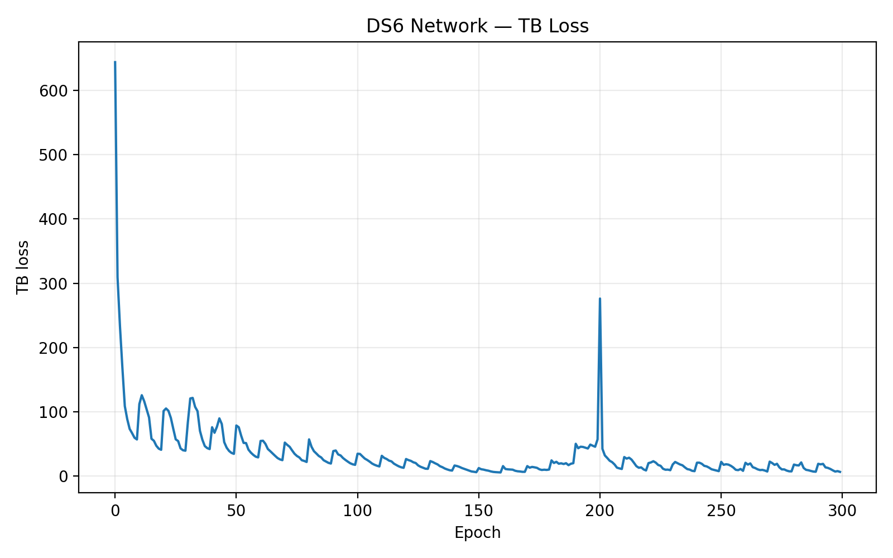
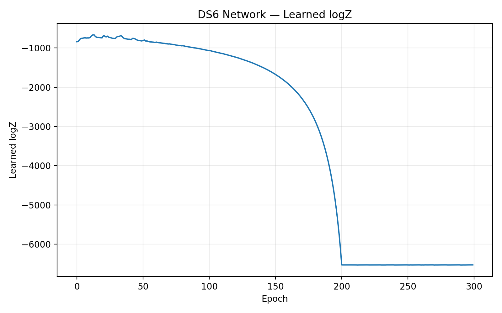
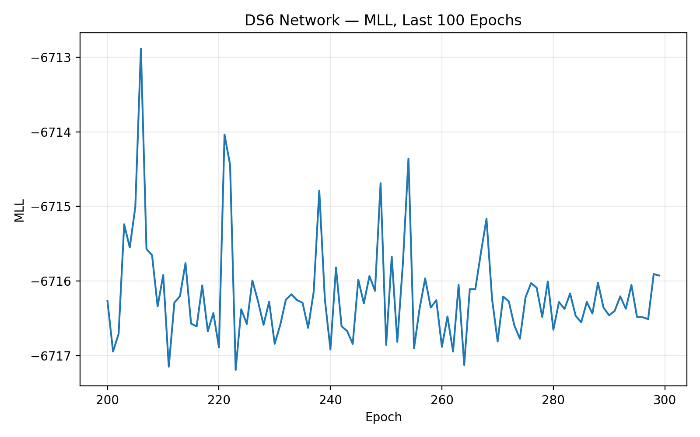
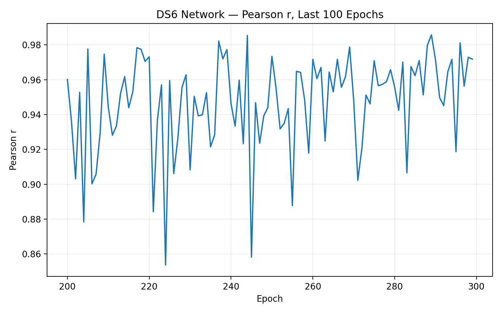
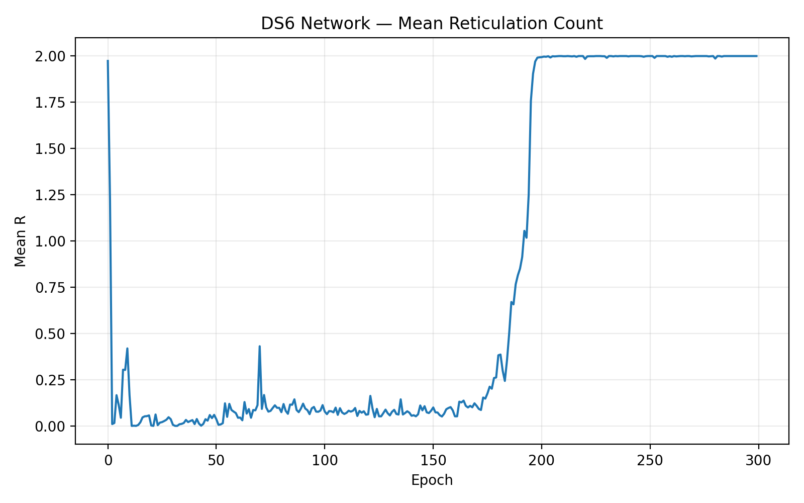
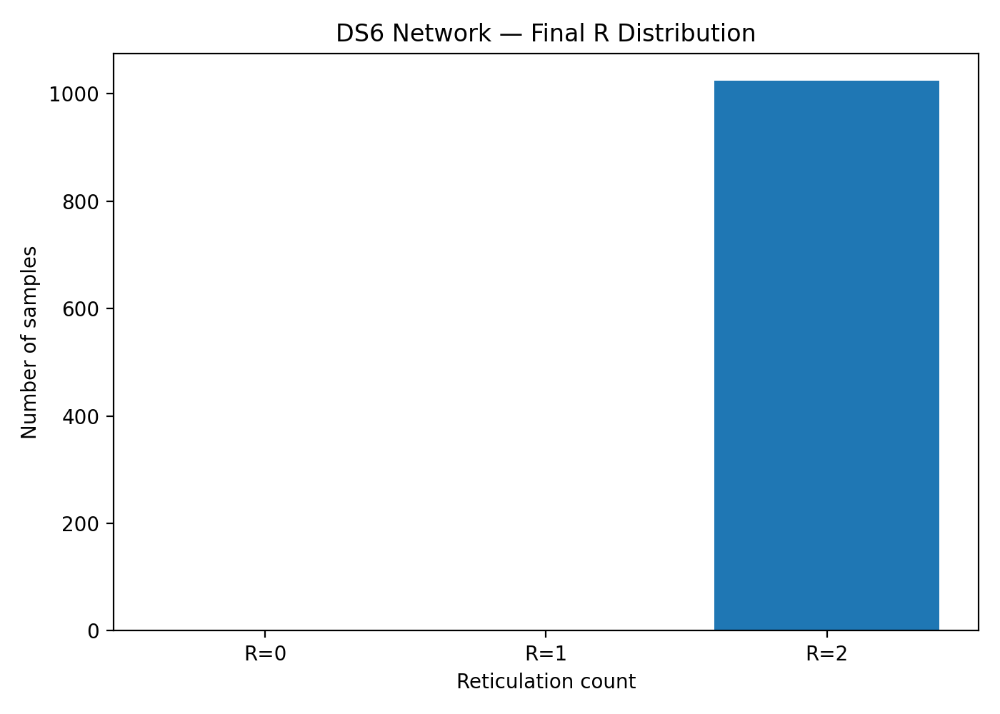
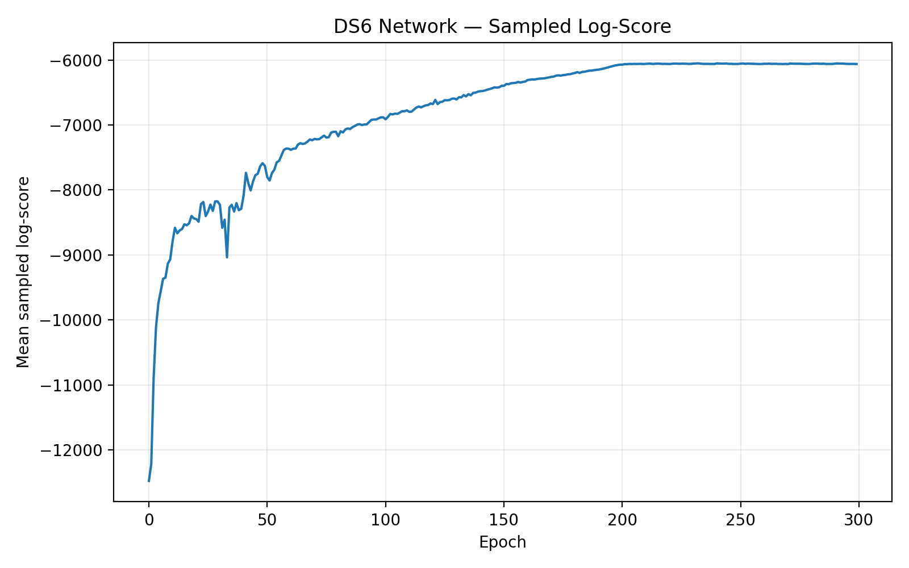
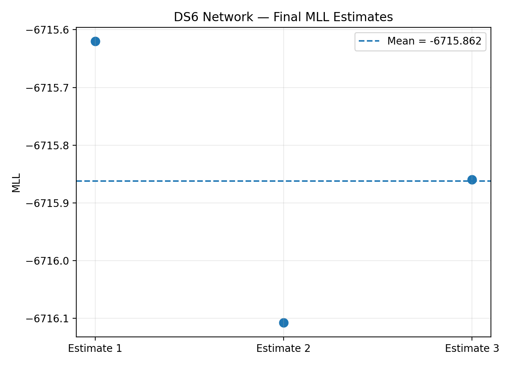
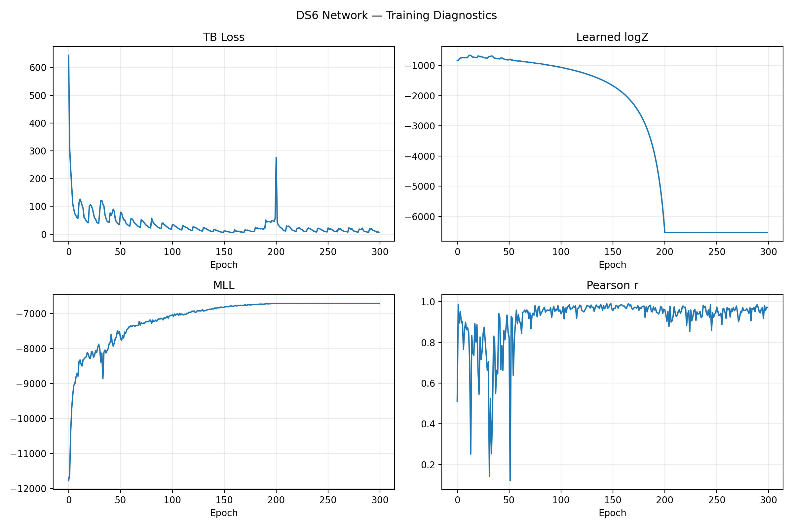

# DS6 — Network baseline without KNN

This directory contains the 300-epoch PhyloGFN network baseline results for DS6 with KNN disabled.

## Final MLL

Three final estimates:

- `-6715.620117187500`
- `-6716.107421875000`
- `-6715.859375000000`

Mean: **-6715.862305**

Sample SD: **0.243666**

## Epoch 299

- TB loss: `6.806073`
- learned logZ: `-6529.500977`
- raw MLL: `-6715.926758`
- Pearson r: `0.971809`
- mean R: `2.0`
- R histogram: `[0, 0, 1024]`
- sampled log-score mean: `-6061.319095`

## Figures

